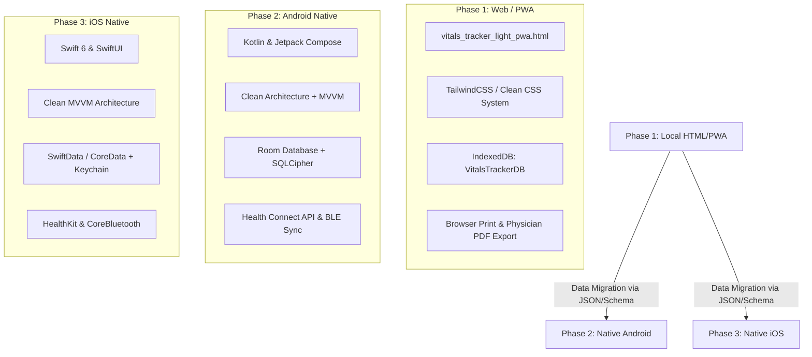

# GEMINI.md — Vitals Monitoring Project

## 1. Project Overview & Vision

**Vitals Tracker** is a private, offline-first personal health vitals monitoring application designed to record, analyze, and visualize daily cardiovascular, metabolic, and physical metrics (Blood Pressure, Pulse, Blood Glucose, SpO2, Weight, Body Temperature, and Waist Circumference).

The primary clinical focus is **hypertension and metabolic monitoring**, featuring:
- **Segregated AM/PM Reading Analysis** (Trough vs. Peak) & Morning Surge Detection.
- **Structured Medication & Compliance Tracking** with daily intake checklists and adherence scoring.
- **Modern Physician Consultation Report** formatted for clinical review (A4/Letter print and PDF).
- **Multi-Profile Management** for families and caregivers with a profile-first entry gate.
- **Zero Cloud Leakage**: 100% offline, local browser storage (`IndexedDB` & `localStorage`).

### Evolution Strategy (3-Phase Roadmap)
1. **Phase 1 (Current Baseline):** HTML5 / Vanilla JS / Tailwind CSS PWA single-page application running locally in modern web browsers with offline storage (`IndexedDB` / `localStorage`).
2. **Phase 2 (Android Native):** Independent native Android app built with **Kotlin**, **Jetpack Compose**, **Room DB** (SQLite/SQLCipher), with optional **Health Connect** and BLE monitor integration.
3. **Phase 3 (iOS Native):** Independent native iOS app built with **Swift**, **SwiftUI**, **SwiftData / CoreData**, with optional **Apple HealthKit** and BLE monitor sync.

---

## 2. Core Architectural & UX Principles

- **Zero Cloud Leakage (Local-First Privacy):** All medical records remain strictly on the user's device. No mandatory remote backends, telemetry, or external third-party tracking.
- **Profile-First Gated Entry & Session Switch:**
  - Whenever the application launches, the **initial view must always be the Profile Selection Screen**.
  - A prominent **"Log Out / Switch Profile"** button is always available in the UI to return to the profile selection screen at any time.
- **Context-Sensitive Data Entry:**
  - `medTiming` (e.g., "Before Meds", "Post Meds", "Fasting") is **strictly relevant only to Blood Pressure and Blood Glucose readings**.
  - For other vital types (Weight, Pulse standalone, SpO2, Body Temperature, Waist Circumference), the `medTiming` selector is hidden to keep inputs clean and minimal.
- **Data Portability:** Seamless JSON/CSV import and export to ensure data can migrate between the HTML prototype, Android, and iOS builds without lock-in.
- **Clinical Rigor & Senior-Friendly UX:**
  - Standardized blood pressure classification (AHA/ACC 2017).
  - High contrast, legible typography, large touch targets (min 48×48 dp/pt), and quick-entry drawer flows.
- **HealthLog-Aligned UI Architecture & Component Hierarchy:**
  - The UI layout, information architecture, and visual hierarchy directly reflect the **HealthLog** interface patterns:
    1. **Today Overview & Lead Status Sentence:** Dashboard opens with a clear headline summarizing today's vitals status and pending tasks (e.g., *"Blood pressure is within target range • 1 medication dose pending today"*).
    2. **Today's Action Strip ("Medication Quick-Add"):** Prominent daily dose checklist on the home screen enabling one-tap intake recording (`Taken` / `Skip` / `Late`) with compliance badges.
    3. **Metric Tiles with 7-Day Sparkline Trends:** Clean, rounded cards for each vital displaying latest value, unit, timestamp, clinical category badge, and an inline SVG mini trend line.
    4. **Bottom Slide-Over Quick-Entry Drawer:** Seamless bottom sheet for rapid data entry with context-sensitive inputs (`medTiming` strictly filtered to BP & Glucose).
    5. **Multi-Range Trends View:** Deep-dive tabs (7d, 14d, 30d, 90d, All) featuring clinical reference bands (Normal, Elevated, Stage 1/2) shaded behind trend charts.
    6. **Physician Consultation Sheet:** High-contrast, tabular clinical summary ready for A4/Letter print or PDF export.
- **Continuous App Versioning Protocol:**
  - The active app version must always be displayed visibly at the bottom of the page (footer).
  - Before applying changes, determine whether an update is a **Minor** or **Major** version upgrade:
    - **Minor Update:** Antigravity auto-increments the decimal version (e.g., `v5.1` → `v5.2`).
    - **Major Update:** The user must be asked to confirm or provide the new major version number (e.g., `v6.0`).

---

## 3. Technology Stack by Phase



---

## 4. Shared Data Model & Schema Specifications

To maintain seamless interoperability when transitioning between the HTML web prototype and mobile platforms, the following standardized schema must be upheld:

### Profile Entity (`UserProfile`)
*(Note: `relation` and `bpTarget` are removed per user requirements).*

```typescript
interface UserProfile {
  id: number;                 // Integer Primary Key (auto-increment)
  name: string;               // Display name (e.g., "Demo", "Father")
  gender?: "Male" | "Female" | "Other";
  dob?: string;               // ISO-8601 Date (YYYY-MM-DD)
  age?: number;               // Optional explicit age
  heightCm?: number;          // Height in cm (enables BMI & Waist-to-Height calculations)
  condition?: string;         // e.g., "Hypertension, Type 2 Diabetes"
  bloodGroup?: string;        // e.g., "O+", "B+"
  notes?: string;             // General caregiver/clinical notes
  createdAt: string;          // ISO-8601 Timestamp
  updatedAt?: string;         // ISO-8601 Timestamp
}
```

### The 7 Captured Home Vitals (`VitalRecord`)
Captures all 7 home-accessible parameters:

```typescript
interface VitalRecord {
  id?: number;                // Primary Key (auto-increment)
  profileId: number;          // Foreign key to UserProfile
  timestamp: string;          // ISO-8601 Timestamp (e.g., "2026-10-11T08:30:00.000Z")

  // 1. Cardiovascular
  systolic?: number | null;   // mmHg (e.g., 120)
  diastolic?: number | null;  // mmHg (e.g., 80)
  pulse?: number | null;      // bpm (e.g. 72)

  // 2. Metabolic
  glucose?: number | null;    // mg/dL (e.g., 95)
  glucoseType?: "Fasting" | "Post-Prandial" | "Random" | "Bedtime" | null;

  // 3. Body & Anthropometrics
  weight?: number | null;     // kg (e.g., 82.5)
  waist?: number | null;      // cm (e.g., 88.0)

  // 4. Respiratory & Temperature
  spo2?: number | null;       // % Blood Oxygen (e.g., 99)
  temp?: number | null;       // °F or °C (e.g., 98.6)

  // Context & Notes (medTiming ONLY rendered for BP and Glucose)
  medTiming?: "Before Telmikind / Meds" | "Post Meds" | "Random" | "Fasting" | string | null;
  notes?: string;             // Free text user note

  // ─── Computed Clinical Fields (Derived On-the-Fly) ───
  // • window: "AM" (05:00-11:59) | "PM" (18:00-23:59) | "OTHER"
  // • map: Diastolic + (1/3) * (Systolic - Diastolic)
  // • pulsePressure: Systolic - Diastolic
  // • bpStage: "Normal" | "Elevated" | "Stage 1" | "Stage 2" | "Crisis"
  // • bmi: weight / (heightInMeters ^ 2) [when heightCm is populated]
  // • whtr: waist / heightCm [when heightCm is populated]
}
```

### Medication Entity (`Medication`)

```typescript
interface Medication {
  id: string;                 // UUID or slug (e.g., "med-1")
  profileId: number;          // Associated UserProfile ID
  name: string;               // e.g., "Telmikind", "Metformin"
  dosage: string;             // e.g., "40mg", "500mg"
  scheduleType: "scheduled" | "prn"; // Scheduled vs. As-needed / SOS
  frequency: "morning" | "evening" | "twice_daily" | "thrice_daily" | "custom";
  timeSlots: string[];        // Standard times, e.g. ["08:00"] or ["08:00", "20:00"]
  instructions?: string;      // e.g., "Take before breakfast on empty stomach"
  active: boolean;            // true = currently active; false = stopped/paused
  createdAt: string;          // ISO-8601 Timestamp
}
```

### Medication Intake Audit Ledger (`MedicationIntakeEvent`)

```typescript
interface MedicationIntakeEvent {
  id: string;                 // UUID (e.g., "intake-20261011-med1-am")
  profileId: number;          // Associated UserProfile ID
  medicationId: string;       // Foreign key to Medication
  scheduledDate: string;      // Local Date "YYYY-MM-DD"
  slot: "morning" | "evening" | "afternoon" | "bedtime" | "prn";
  status: "taken" | "late" | "skipped" | "missed";
  timestamp: string;          // ISO-8601 Timestamp of user action
  notes?: string;             // Optional user notes
}
```

### Universal Backup & Restore Structure (`BackupSchema`)

```typescript
interface AppBackupData {
  app: "Vitals Tracker";
  version: string;            // e.g., "6.0"
  exportDate: string;         // ISO-8601
  profiles: UserProfile[];
  vitals: VitalRecord[];
  medications: Medication[];
  medicationIntakes: MedicationIntakeEvent[];
}
```

---

## 5. Clinical Guidelines & Calculation Rules

### 1. Blood Pressure Classifications (AHA/ACC 2017)
- **Normal:** Systolic < 120 **and** Diastolic < 80 mmHg.
- **Elevated:** Systolic 120–129 **and** Diastolic < 80 mmHg.
- **Hypertension Stage 1:** Systolic 130–139 **or** Diastolic 80–89 mmHg.
- **Hypertension Stage 2:** Systolic ≥ 140 **or** Diastolic ≥ 90 mmHg.
- **Hypertensive Crisis:** Systolic > 180 **and/or** Diastolic > 120 mmHg *(Trigger immediate medical attention warning)*.

### 2. Derived Cardiovascular Indicators
- **Mean Arterial Pressure (MAP):**
  $$\text{MAP} = \text{Diastolic} + \frac{1}{3} \times (\text{Systolic} - \text{Diastolic})$$
- **Pulse Pressure (PP):**
  $$\text{PP} = \text{Systolic} - \text{Diastolic} \quad (\text{Warning threshold if } \text{PP} > 60\text{ mmHg})$$
- **AM/PM Segregation & Morning Surge Differential:**
  - **AM Window:** 05:00 to 11:59 (Trough reading, before morning medication).
  - **PM Window:** 18:00 to 23:59 (Evening reading).
  - **Morning Surge Alert:** Trigger warning banner if:
    $$\Delta \text{Systolic}_{\text{Surge}} = \text{Mean Systolic}_{\text{AM}} - \text{Mean Systolic}_{\text{PM}} \ge 20\text{ mmHg}$$

### 3. Medication Adherence Rate
$$\text{Compliance Rate (\%)} = \left( \frac{\text{Doses Logged as Taken or Late}}{\text{Total Scheduled Doses in Period}} \right) \times 100$$
- $\ge 80\%$: Optimal / High Adherence (Green badge).
- $50\% - 79\%$: Moderate Adherence (Amber badge).
- $< 50\%$: Poor Adherence (Rose badge).

### 4. Modern Physician Consultation Sheet
- Formatted via `@media print` for high-resolution A4 and US Letter paper/PDF export.
- Includes:
  - Patient Header: Name, Age, Gender, Conditions, Review Window (7/14/30/90 days).
  - Blood Pressure & Pulse Overview: Overall Average, AM Average, PM Average, Surge Delta.
  - Stage Distribution Breakdown (% in Normal, Elevated, Stage 1, Stage 2, Crisis).
  - Metabolic & Vitals Snapshot (Glucose by context, Weight trend, SpO2 stability).
  - Prescribed Medication Regimen with Adherence Rate %.
  - Clinical Notes section.
  - Enforced Clinical Disclaimer:
    > *"This application is for personal tracking and informational purposes only. It is not a substitute for professional medical advice, diagnosis, or treatment."*

---

## 6. Project Directory Structure

```text
/
├── GEMINI.md                       # Project rules, architecture, and roadmap
├── vitals_tracker_light_pwa.html   # Phase 1: Standalone Web/PWA prototype
├── shared/                         # Shared schemas & mock fixtures
│   ├── schemas/                    # JSON schema definitions (vitals, profiles)
│   └── samples/                    # Sample export/import JSON files
├── android/                        # Phase 2: Native Android app
│   ├── app/
│   │   ├── src/main/java/com/vitals/tracker/
│   │   │   ├── data/               # Room entities, DAOs, repositories
│   │   │   ├── domain/             # Clinical rules, calculation use-cases
│   │   │   └── ui/                 # Jetpack Compose screens & components
│   │   └── build.gradle.kts
│   └── settings.gradle.kts
└── ios/                            # Phase 3: Native iOS app
    ├── VitalsTracker/
    │   ├── Models/                 # SwiftData entities
    │   ├── Clinical/               # BP calculation engines & categorizers
    │   ├── Views/                  # SwiftUI screens (Dashboard, Logs, DoctorSummary)
    │   └── ViewModels/             # Observable view models
    └── VitalsTracker.xcodeproj
```

---

## 7. Guidelines for AI Agents Working on This Project

1. **Maintain Offline-First Integrity:** Do not introduce external dependencies that require network calls or cloud services for core functionality.
2. **Profile Selection Gating:** On page load, the application must verify active session state and present the Profile Selection screen if not already selected. The "Log Out / Switch Profile" action must cleanly route back to the selection screen.
3. **Context-Sensitive Forms:** Never show `medTiming` on forms other than Blood Pressure and Blood Glucose.
4. **Versioning Protocol:**
   - Display the version in the footer at the bottom of the page.
   - For minor revisions, auto-increment the decimal (e.g., `v5.1` → `v5.2`).
   - For major revisions, ask the user to enter the major version number.
5. **Medical Disclaimer Enforcement:** Always render the clinical disclaimer on all print summaries and analytical dashboards.
6. **Backward Compatibility:** All modifications must cleanly migrate previous `v5.1` `IndexedDB` and JSON backup data without loss.
